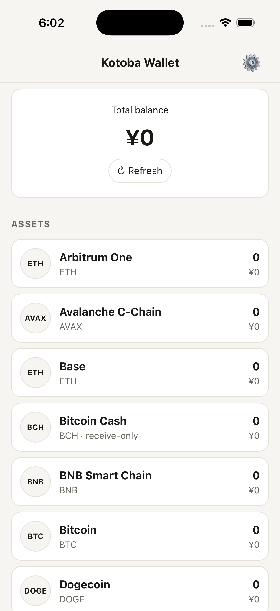
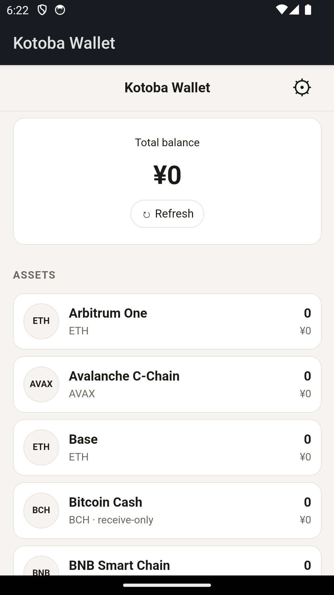

# Kotoba Wallet

Kotoba Wallet は [kotoba-lang/shell](https://github.com/kotoba-lang/shell) 上に作った、non-custodial のマルチチェーン・ウォレットです。iOS / Android / macOS で動きます。
アカウント導出と署名は [kotoba-lang/wallet](https://github.com/kotoba-lang/wallet) と**バイト一致**するよう検査しています。

| iOS | Android |
|---|---|
|  |  |

- **12 チェーン**: ETH · BNB · Polygon · Avalanche · Arbitrum · Optimism · Base · BTC · LTC · DOGE · BCH (受取専用) · TRX。
  準備中の 10 チェーン (SOL, XRP, TON …) は、何が足りないかを表示して導出を拒否します。
- **法定通貨表示**: JPY / USD / EUR / GBP / CNY / KRW (CoinGecko)
- **受取**: QR とアドレスのコピー
- **送金**: EVM 7 チェーン (EIP-1559) と BTC / LTC / DOGE (P2WPKH・P2PKH の UTXO、RBF、全額送金、手数料 3 段階)。BCH と TRX は受け取りのみ
- **Kotoba L1 (inga)**: 同じ seed から作る Ed25519 did:key で、ref の記録 (`inga.ref-record/v2`) に署名し inga-node へ提出します。inga に残高の概念は無いので、ここで持つのは書き込み権限です
- **鍵**: ニーモニックはパスコードで暗号化し (PBKDF2 + AES-256-GCM)、OS キーチェーンに保存します。ロック解除中にメモリに置くのは公開アカウントだけです。

設計: [docs/adr/ADR-2610131800-kotoba-wallet-app.md](docs/adr/ADR-2610131800-kotoba-wallet-app.md)

## 開発

```sh
npm ci
npm test            # wallet / inga.writer / btc-signer とのパリティ検査 (55 tests)
node scripts/inga-oracle.mjs   # inga.writer の判定を再生成 (kbb と ../inga, ../text が必要)
npm run build       # web/dist (kotoba-shell が埋め込む web bundle)
npm run oracle      # test/fixtures/oracle.json を本物の wallet ライブラリから再生成 (JVM Clojure が必要)
```

## アプリのビルド

```sh
sh scripts/build-app.sh ios        # KOTOBA_SHELL=<kotoba-lang/shell のパス> (既定は ../shell)
sh scripts/build-app.sh android    # JDK 17/21 が必要 (JDK 26 では Gradle が失敗する)
```

`build-app.sh` は `app scaffold` → `app build --execute` の順に実行します。`app build` だけでは web bundle が更新されません。
App Store / Play 向けの署名付き package は `kotoba-shell app package` に team id か keystore を渡して作ります (未検証)。

## 構成

```
src/core/derive.js    BIP-39/32/44 導出、EVM / UTXO (P2PKH, P2WPKH, cashaddr) / TRON アドレス
src/core/evm.js       RLP、EIP-1559 / EIP-155 署名、chain-id 不一致の拒否、単位変換
src/core/utxo.js      UTXO: アドレス→script、legacy / BIP-143 sighash、コイン選択、組み立て
src/core/inga.js      Kotoba L1: SLIP-0010 Ed25519、did:key、inga.ref-record/v2 の署名
src/core/keystore.js  vault (PBKDF2-HMAC-SHA256 + AES-256-GCM)
src/core/networks.js  残高 / 価格 / broadcast のエンドポイント (kotoba-shell http/fetch 経由)
src/core/chains.json  wallet.chains (oracle から抽出したもの。手で編集しない)
src/ui/               画面 (素の DOM)、i18n (ja/en)、保存先 (keychain bridge)
app.kotoba.edn        kotoba-shell manifest
shell-policy.edn      bridge policy (最小権限)
oracle/oracle.clj     パリティ oracle (wallet ライブラリを JVM で実行する)
```

## セキュリティ

これは v0.1 です。外部の監査は受けていません。多額の資金には使わないでください。

License: Apache-2.0
